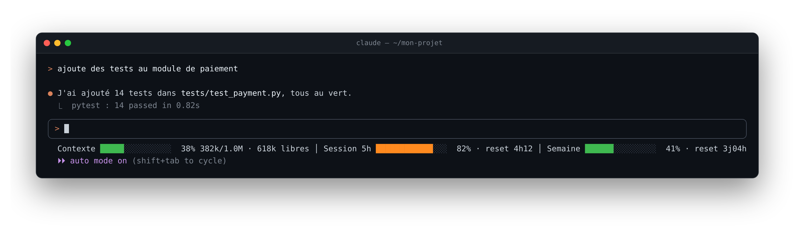
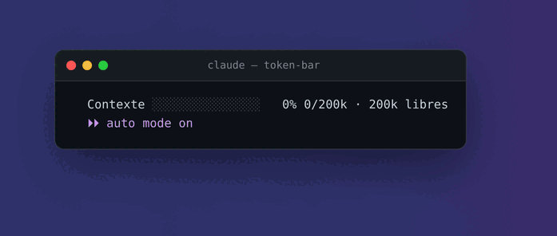
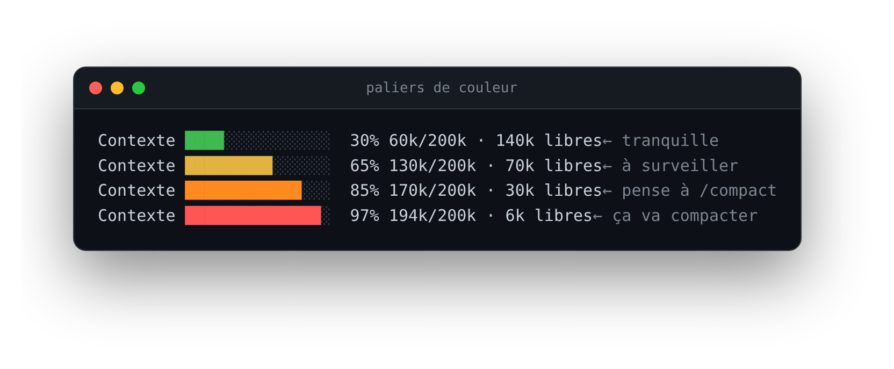

<div align="center">

# ⛽ token-bar

**Ta conso de tokens Claude Code en un coup d'œil, juste sous le prompt.**

[](https://github.com/Kestrall/claude-token-bar/actions/workflows/ci.yml)
[](https://github.com/Kestrall/claude-token-bar/releases)
[](LICENSE)
[](https://docs.claude.com/en/docs/claude-code/statusline)
[](skill/statusline.sh)
[](#installation)
[](https://github.com/Kestrall/claude-token-bar/stargazers)



</div>

## Pourquoi ?

Claude Code ne montre pas en permanence où tu en es. Résultat : la conversation se compacte au mauvais moment, ou tu tombes sur la limite de ton abonnement en plein travail. **token-bar** affiche trois jauges qui se mettent à jour toute seules :

| Jauge | Ce qu'elle montre |
|---|---|
| **Contexte** | La mémoire de la conversation en cours : tokens utilisés, taille max, et ce qui reste libre avant que Claude Code compacte |
| **Session 5h** | Ta consommation sur la fenêtre glissante de 5 h de l'abonnement, et dans combien de temps elle se remet à zéro |
| **Semaine** | Pareil sur la limite hebdomadaire |

Les jauges **Session 5h** et **Semaine** apparaissent avec un abonnement Pro / Max. En usage API, seule **Contexte** s'affiche.

## Les couleurs parlent d'elles-mêmes

<div align="center">

</div>

<div align="center">

</div>

| | Seuil | Conseil |
|---|---|---|
| 🟢 | moins de 60 % | tout va bien |
| 🟡 | 60 à 80 % | garde un œil dessus |
| 🟠 | 80 à 95 % | bon moment pour `/compact` ou une nouvelle session |
| 🔴 | 95 % et plus | ça va compacter, ou la limite est toute proche |

## Installation

Prérequis : `bash` et [`jq`](https://jqlang.org/) (`sudo apt install jq` ou `brew install jq`).

```bash
git clone https://github.com/Kestrall/claude-token-bar.git
cd claude-token-bar
./install.sh
```

Relance Claude Code : les jauges apparaissent sous le prompt. ✨

<details>
<summary>Ce que fait l'installeur</summary>

- copie le skill dans `~/.claude/skills/token-bar/`
- ajoute la clé `statusLine` dans `~/.claude/settings.json`, sans toucher au reste
- sauvegarde l'ancien fichier en `settings.json.bak-token-bar`
- te demande avant d'écraser une status line déjà configurée
- respecte `CLAUDE_CONFIG_DIR` si tu l'utilises

</details>

Pour tout retirer : `./uninstall.sh`

## Pilote-le en parlant à Claude

token-bar s'installe aussi comme **skill Claude Code**. Pas besoin d'éditer de fichiers, demande simplement :

> « désactive la barre de tokens »
> « mets des jauges plus larges »
> « la barre n'affiche plus rien, regarde pourquoi »

## Personnaliser

| Quoi | Comment |
|---|---|
| Largeur des jauges | Préfixe la commande dans `settings.json` : `TOKEN_BAR_WIDTH=25 ~/.claude/skills/token-bar/statusline.sh` (15 par défaut) |
| Seuils, couleurs | Fonction `bar()` dans [`skill/statusline.sh`](skill/statusline.sh) |
| Dépannage | Préfixe par `TOKEN_BAR_DEBUG=1` : le dernier JSON reçu est écrit dans `~/.claude/skills/token-bar/last-input.json` |

La ligne fait environ 130 colonnes avec les trois jauges. Sur un terminal étroit, baisse `TOKEN_BAR_WIDTH`.

## Comment ça marche

Claude Code exécute la commande `statusLine` à chaque rafraîchissement et lui envoie sur stdin un JSON décrivant la session (`context_window`, `rate_limits`…). Le script le lit avec `jq` et dessine les jauges en couleurs ANSI.

🔒 **100 % local** : aucun appel réseau, aucune donnée envoyée nulle part.

Doc officielle : [Status line](https://docs.claude.com/en/docs/claude-code/statusline).

## Développement

```bash
tests/run.sh            # tests du rendu sur des sessions d'exemple (tests/fixtures/)
python3 docs/render.py  # régénère les visuels du README depuis la vraie sortie du script
```

La CI lance ShellCheck et les tests sur Linux et macOS à chaque push.

## Licence

[MIT](LICENSE). Fais-en ce que tu veux, une ⭐ fait toujours plaisir.
